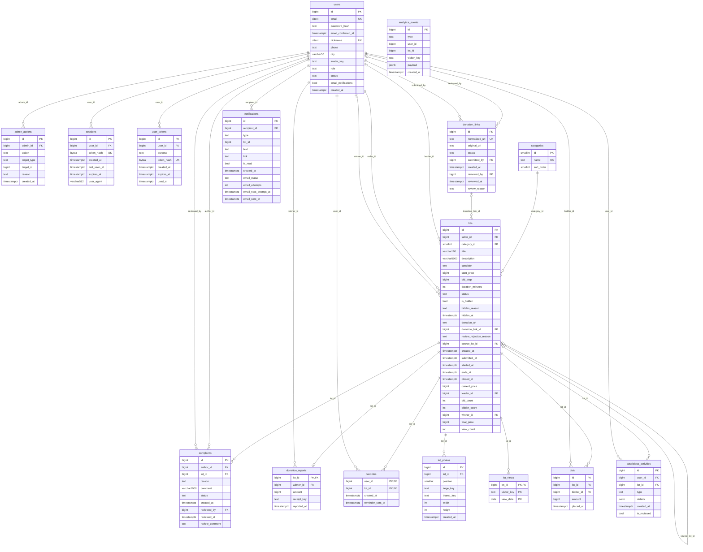

# ER-діаграма бази даних

Діаграма побудована з реальної схеми PostgreSQL, яку створюють міграції `UsersAndPlatformTables`, `LotsAndCharityTables` і `BiddingTables` (SITE-14, SITE-15, SITE-16). Типи, ключі й зв'язки взято з системного каталогу бази, а не з коду, тому вони збігаються з тим, що отримає сервер після `migrate`.

Позначки: `PK` первинний ключ, `FK` зовнішній ключ, `UK` унікальне значення. Зв'язок `||--o{` означає «один до багатьох», `|o--o{` те саме з необов'язковим посиланням, `||--o|` один до нуля або одного.

## Діаграма

## Таблиці за модулями

| Модуль | Таблиці |
|---|---|
| Platform | `admin_actions`, `analytics_events` |
| Users | `users`, `sessions`, `user_tokens`, `complaints` |
| Lots | `categories`, `lots`, `lot_photos`, `favorites`, `lot_views`, `donation_links`, `donation_reports` |
| Bidding | `bids`, `notifications`, `suspicious_activities` |

Усього 16 таблиць і 25 зовнішніх ключів. Правило видалення `restrict` мають 18 ключів, `cascade` такі:

- `sessions.user_id` → `users`
- `user_tokens.user_id` → `users`
- `favorites.lot_id` → `lots`
- `favorites.user_id` → `users`
- `lot_photos.lot_id` → `lots`
- `lot_views.lot_id` → `lots`
- `notifications.recipient_id` → `users`

## Перевірка закладок під v2.0 (project.md §9.13)

Висновок: схема не блокує жодну функцію v2.0. Для кожної потрібні нові таблиці або необов'язкові колонки, переписувати наявні таблиці не доведеться. Нижче наведено, що вже закладено і що доведеться змінити.

| Функція | Ключ | Закладено | Що додати або вирішити |
|---|---|---|---|
| Автоставки до максимуму | SITE-39 | `bids` зберігає автора (`bidder_id`) і суму (`amount`), тож автоставка є звичайною ставкою від імені користувача. `UNIQUE (lot_id, amount)` їй не заважає | Нова таблиця `auto_bids (lot_id, user_id, max_amount)`; таблицю `bids` змінювати не потрібно |
| «Купити зараз» | SITE-40 | Лот має `winner_id` і `final_price`, які можна заповнити без ставки | Необов'язкова колонка `lots.buy_now_price`. Якщо викуп завершує лот зі статусом `sold`, інших змін немає. Якщо потрібен новий статус, доведеться змінити `ck_lots_status` і `ck_lots_final_price_when_closed` |
| Рейтинг і відгуки | SITE-41 | `lots.seller_id` і `lots.winner_id` для лота `sold` однозначно задають сторони угоди, а `donation_reports` додає підтвердження переможця | Нова таблиця `reviews` з посиланням на лот і автора |
| Аналітика цін | SITE-42 | `lots.final_price`, `category_id`, `condition` і `closed_at` лишаються назавжди: у моделі немає видалення лотів, а ключі зі ставок, скарг і звітів мають `restrict`. Індекс `(status, closed_at desc)` вже є | Індекс `(category_id, closed_at)`, коли з'являться запити по категорії. Бажано заборонити `DELETE` на `lots` правами ролі БД, бо фото, обрані й перегляди видаляються каскадом разом з лотом |
| Оплата і просування | SITE-43 | Комісію 5% можна рахувати від `final_price`, колонка вже зберігається | Необов'язкова колонка `lots.promoted_until`, таблиця платежів. **Відкрите питання:** за `design/14-charity.md` 100% фінальної ціни йде на збір (відхилення X1), а v2.0 передбачає комісію; модель комісії треба узгодити з командою |
| PWA | SITE-44 | Сповіщення вже окрема таблиця `notifications` | Стан доставки в ній прив'язаний до листів (`email_status`, `email_attempts`, `email_next_attempt_at`, `email_sent_at` і їхні `CHECK`). Для push краще нова таблиця `notification_deliveries (notification_id, channel, status, attempts)` і таблиця підписок пристроїв, а не нові колонки |
| Рекомендації схожих лотів | — | `lots.category_id` і `condition`, індекс `(category_id, status, is_hidden)`, а також `favorites` і `lot_views` як сигнали | Нічого не потрібно для першої версії рекомендацій |

Дата побудови: 2026-11-16.
